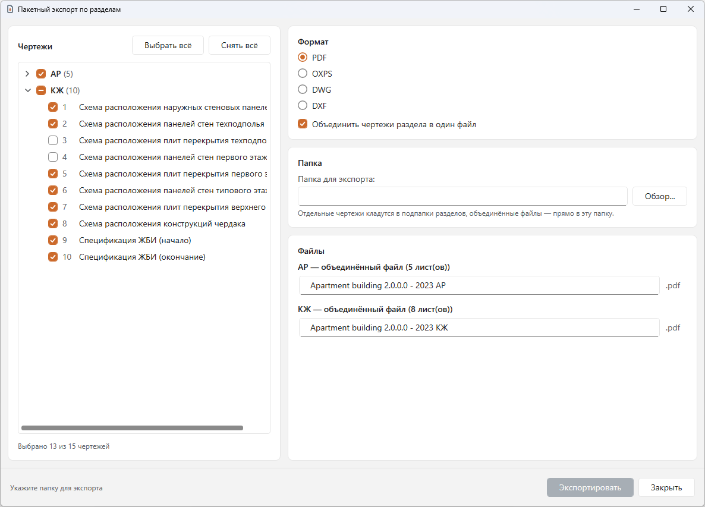

# Пакетный экспорт по разделам для Renga

Плагин для [Renga](https://rengabim.com): экспортирует чертежи проекта пакетно, по разделам, в PDF/OXPS/DWG/DXF — без ручного экспорта каждого листа по отдельности.

**Версия 0.3**

## Возможности
- Одно окно в стиле Windows 11: слева дерево чертежей по разделам с флажками и кнопками «Выбрать всё»/«Снять всё», справа формат, папка и список файлов.
- Форматы: PDF, OXPS, DWG, DXF; для DWG/DXF — выбор версии AutoCAD и опции экспорта материала поверхностей/фона текста.
- Опция «Объединить чертежи раздела в один файл» (для PDF/OXPS).
- Список «Файлы» обновляется сразу при любом изменении выбора: видно, какие файлы будут созданы. Имена можно править прямо в списке; конфликтующие имена подсвечиваются, экспорт заблокирован, пока конфликт не устранён; уже существующие в папке файлы помечаются как «будет перезаписан».
- Ход экспорта виден в строке состояния («Экспорт: 12 из 48…»), итог — «Готово: создано N файлов». Окно после экспорта не закрывается.
- Имя папки экспорта включает имя файла модели Renga — чертежи из разных проектов с одинаковым названием раздела не перезаписывают друг друга при экспорте в одну и ту же папку.

## Ограничения
- Раздел и номер листа берутся из данных проекта Renga; если у чертежа не задан раздел, он экспортируется в группу «Без раздела».
- Объединение в один файл доступно только для PDF/OXPS (у DWG/DXF нет понятия «несколько чертежей в одном файле»).

## Требования
- Windows, Renga с поддержкой плагинов .NET 8 (в манифесте указан API 2.49).

## Установка
1. Скачайте архив `SectionBatchExport-0.3.zip` на странице [Releases](../../releases).
2. Закройте Renga.
3. Распакуйте архив и скопируйте папку `SectionBatchExport` в `C:\Program Files\Renga Professional\Plugins\` (потребуется подтверждение администратора). Если стояла старая версия — предварительно удалите её папку.
4. Запустите Renga: пункт «Пакетный экспорт по разделам» появится в меню «Экспорт».

Если пункта нет, проверьте журнал `%localappdata%\Renga Software\Renga\AecApp.log`.

## Удаление
Закройте Renga и удалите папку `Plugins\SectionBatchExport`.

## О разработке
Плагин разработан с помощью искусственного интеллекта (Claude, Anthropic) под руководством автора. Работа плагина проверена автором в Renga, но программа поставляется «как есть», без гарантий: перед использованием на важных проектах проверьте результат экспорта.

## Лицензия
Все права защищены, см. [LICENSE](LICENSE). Исходный код не публикуется. Сторонние компоненты: сборки Renga SDK.
